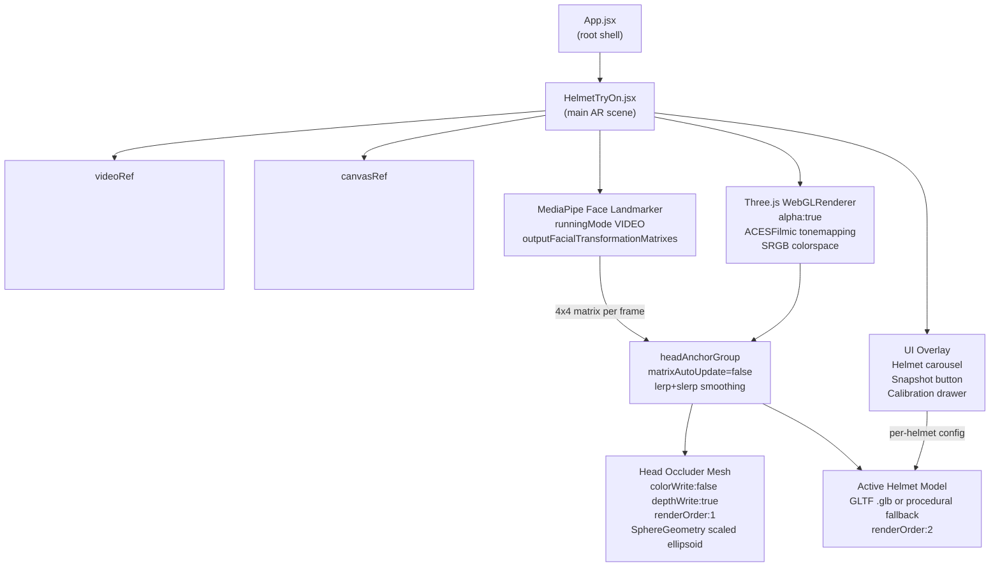
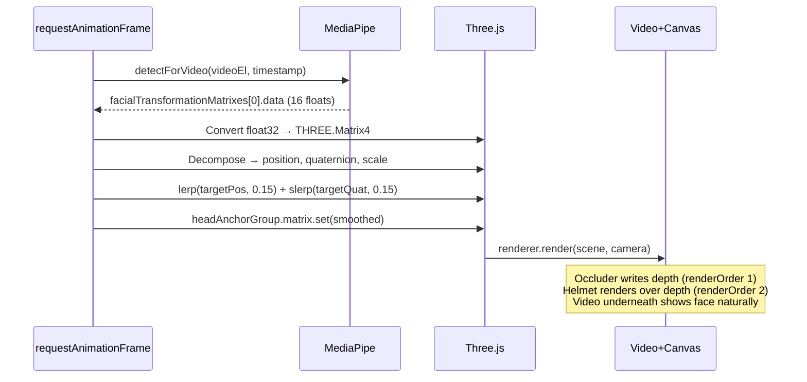

# 🪖 Virtual Helmet Try-On App — Complete Build Plan

## Project Summary
A production-ready, web-based AR helmet try-on application that overlays real-time 3D helmet models anchored to the user's head via face tracking — running entirely in the browser with no backend.

---

## Tech Stack Decision Matrix

| Concern | Choice | Reason |
|---|---|---|
| Bundler | Vite 5 | Instant HMR, ESM-native, fastest dev cycle |
| UI Framework | React 18 | Component model, hooks for state/lifecycle |
| 3D Engine | Three.js r165 | GLTFLoader, PBR, WebGLRenderer alpha canvas |
| Face Tracking | @mediapipe/tasks-vision 0.10.x | Google's official SDK; `outputFacialTransformationMatrixes` gives full 4×4 head pose |
| Styling | Tailwind CSS v3 | Utility-first, mobile-first, zero runtime cost |
| Icons | lucide-react | Tree-shakeable, consistent SVG icon set |
| Snapshot | html2canvas-free native approach | Canvas API composite of video + WebGL canvas |

---

## Folder Structure

```
3dhelmet/
├── public/
│   └── models/
│       ├── helmet1.glb       ← user drops their own models here
│       ├── helmet2.glb
│       ├── helmet3.glb
│       └── helmet4.glb
├── src/
│   ├── components/
│   │   └── HelmetTryOn.jsx   ← main AR component (camera + Three.js + MediaPipe)
│   ├── data/
│   │   └── helmets.js        ← helmet catalog with per-model calibration
│   ├── utils/
│   │   └── proceduralHelmet.js  ← fallback Three.js geometry helmet
│   ├── App.jsx
│   ├── main.jsx
│   └── index.css             ← Tailwind directives
├── index.html
├── package.json
├── vite.config.js
└── tailwind.config.js
```

---

## Component Architecture



---

## Rendering Pipeline (Frame-by-Frame)



---

## Critical Rendering Rules — Annotated

### 1. Mirror Consistency
- Both `<video>` and `<canvas>` get CSS `transform: scaleX(-1)`
- Three.js scene itself is NOT mirrored; the CSS handles visual flip
- This means MediaPipe raw matrix X-axis maps correctly to mirrored left/right
- Result: turning head left → helmet turns left (true mirror behavior)

### 2. Head Occluder Logic
```
SphereGeometry(0.5, 32, 32)
  → scale (0.82, 1.05, 0.95)   ← head ellipsoid shape
  → position inside helmet cavity
Material:
  colorWrite: false   → invisible to user
  depthWrite: true    → writes to depth buffer
  depthTest: true
  side: THREE.FrontSide
renderOrder: 1

Helmet mesh:
  renderOrder: 2
  → renders AFTER occluder writes depth
  → pixels behind occluder (inside head) are culled
  → user's real face from video shows through naturally
```

### 3. Smoothing Math
```js
// Position smoothing
helmetPos.lerp(targetPos, LERP_ALPHA); // LERP_ALPHA ≈ 0.15

// Rotation smoothing  
helmetQuat.slerp(targetQuat, SLERP_ALPHA); // SLERP_ALPHA ≈ 0.15

// Applied to group matrix each frame
headAnchorGroup.matrix.compose(helmetPos, helmetQuat, helmetScale);
```

### 4. Camera Intrinsics → Three.js Projection
- Determine video stream actual width/height from `videoTrack.getSettings()`
- Set `THREE.PerspectiveCamera` with `fov ≈ 63°` (approximate phone front cam FOV)
- Match `camera.aspect` to container aspect ratio every resize
- This keeps helmet scale consistent regardless of device

---

## State Management (React Hooks)

| State | Type | Purpose |
|---|---|---|
| `selectedHelmetIdx` | number | Which helmet is active |
| `helmetConfigs` | array | Live-updated per-helmet calibration |
| `isLoading` | bool | Show spinner during init |
| `cameraError` | string\|null | Display permission error |
| `showOccluderDebug` | bool | Toggle wireframe occluder |
| `showCalibration` | bool | Toggle calibration drawer |
| `isFaceDetected` | bool | Fade group in/out |

All Three.js refs are `useRef` (never state) to avoid re-render loops inside the RAF loop.

---

## Helmet Model Catalog — `src/data/helmets.js`

Each entry:
```js
{
  id: string,            // unique key for React list
  name: string,          // display name in carousel
  thumbnailColor: string,// CSS color for carousel button
  modelUrl: string,      // path under /public
  scale: number,         // world-space scale
  offset: {x,y,z},      // translation offset from head anchor origin
  rotationOffset: {x,y,z} // Euler offset in radians
}
```

4 helmet slots pre-configured; fallback procedural model activates if `.glb` 404s.

---

## Procedural Fallback Helmet (`src/utils/proceduralHelmet.js`)

Built entirely from Three.js primitives so app boots without any `.glb` files:

| Part | Geometry | Material |
|---|---|---|
| Outer dome | `SphereGeometry(0.5, 32, 32)` upper hemisphere | `MeshStandardMaterial` dark metallic |
| Visor | `SphereGeometry(0.5, 32, 32)` front segment | `MeshPhysicalMaterial` transmission+roughness |
| Chin guard | `CylinderGeometry` lower half arc | Matching shell material |
| Visor trim | `TorusGeometry` around visor edge | Accent color metallic |
| Vents | Small `BoxGeometry` rows on top | Matte dark |

Returns a `THREE.Group` with same interface as a loaded GLTF scene.

---

## Calibration Drawer Sliders

| Slider | Range | Step | Default |
|---|---|---|---|
| Scale | 0.5 – 2.5 | 0.05 | 1.35 |
| Offset X | -1.0 – 1.0 | 0.01 | 0 |
| Offset Y | -1.0 – 1.0 | 0.01 | 0.15 |
| Offset Z | -1.0 – 1.0 | 0.01 | -0.25 |
| Pitch (X rot) | -π – π | 0.01 | 0 |
| Yaw (Y rot) | -π – π | 0.01 | 0 |
| Occluder X | 0.3 – 1.5 | 0.01 | 0.82 |
| Occluder Y | 0.3 – 1.5 | 0.01 | 1.05 |
| Occluder Z | 0.3 – 1.5 | 0.01 | 0.95 |

"Copy Config JSON" button uses `navigator.clipboard.writeText(JSON.stringify(config, null, 2))`.

---

## Snapshot Compositing

```
1. Create offscreen <canvas> at video.videoWidth × video.videoHeight
2. ctx.drawImage(videoEl)              ← raw (un-mirrored) video frame
3. ctx.scale(-1, 1) + translate        ← flip to match selfie view
4. ctx.drawImage(threeCanvas)          ← overlay transparent Three.js canvas
5. canvas.toBlob() → URL.createObjectURL → <a download> click
```

Result: a single PNG with the real face + 3D helmet composited correctly.

---

## MediaPipe Model Loading

```
WASM fileset: https://cdn.jsdelivr.net/npm/@mediapipe/tasks-vision@latest/wasm
Model:        https://storage.googleapis.com/mediapipe-models/face_landmarker/face_landmarker/float16/1/face_landmarker.task
```

Both loaded at runtime — zero local asset management needed.

---

## Lighting Setup

```
THREE.AmbientLight(0xffffff, 0.4)
THREE.DirectionalLight(0xffffff, 1.2)   ← top-right key light
THREE.DirectionalLight(0x8888ff, 0.6)   ← left fill/rim
PMREMGenerator(renderer).fromScene(new RoomEnvironment())
  → scene.environment = envMap          ← IBL for reflections/glossy visors
```

---

## Error Handling & Edge Cases

| Scenario | Handling |
|---|---|
| Camera permission denied | Red error card with retry button |
| `.glb` file 404 / parse error | Silent fallback to procedural helmet |
| MediaPipe WASM load fail | Error message + retry |
| No face detected | `headAnchorGroup.visible = false` (smooth fade) |
| Multiple faces in frame | Only `facialTransformationMatrixes[0]` used |
| Browser resize | Camera aspect + renderer size updated via ResizeObserver |
| Tab hidden | `document.visibilitychange` pauses RAF to save GPU |

---

## Build & Run

```bash
npm create vite@latest 3dhelmet -- --template react
cd 3dhelmet
npm install three @mediapipe/tasks-vision lucide-react
npm install -D tailwindcss postcss autoprefixer
npx tailwindcss init -p
npm run dev
```
